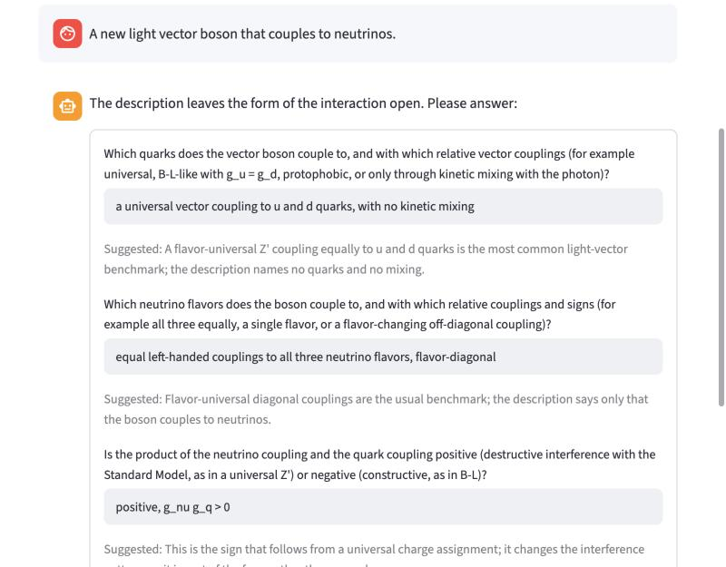
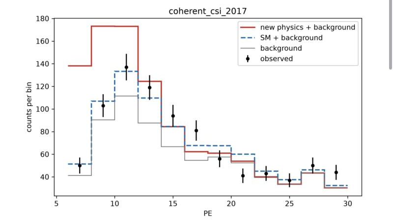
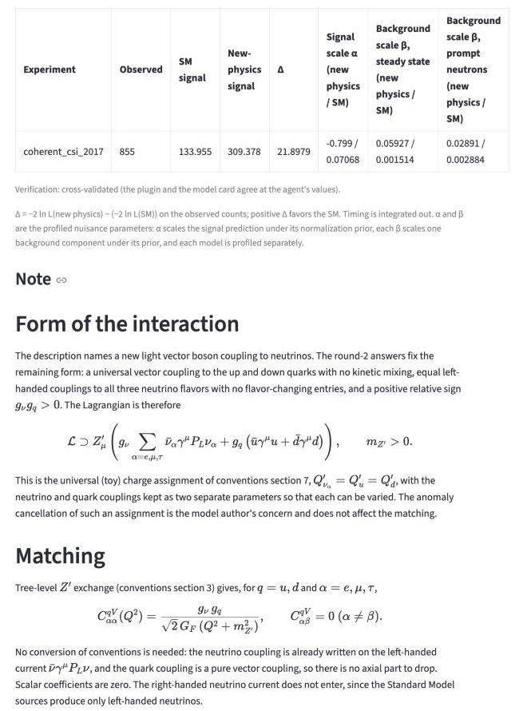
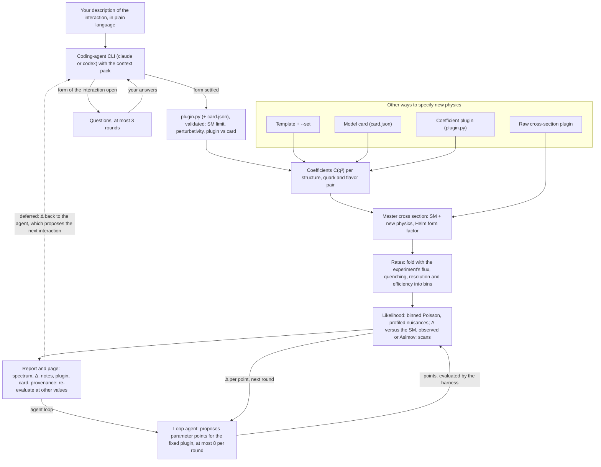

# nuagent

A research prototype for neutrino new physics in coherent elastic neutrino-nucleus scattering (CEvNS). You describe a new interaction; `nuagent` computes the predicted event spectrum for an experiment and reports a log-likelihood or Asimov sensitivity relative to the Standard Model. A coding-agent CLI can translate a plain-language description of the interaction into the coefficient plugin that `nuagent` evaluates.

The local page, top to bottom, for the description "A new light vector boson that couples to neutrinos." on the `claude` backend: the agent asks about the open form of the interaction, the answers go back to it, and the validated translation is evaluated against COHERENT CsI.







## How it works

The research loop this tool automates is: write down a new interaction, translate it into event-rate code, predict the spectrum for an experiment, and compare with the observed counts through a likelihood. Only the translation needs a language model. New physics enters the rest as coefficients in a fixed operator basis (vector and scalar neutrino-quark operators per flavor pair and quark), so interference with the Standard Model (SM) is handled by one master cross section and the SM is added once by the framework.



The agent loop varies only the parameter values of a validated plugin: a separate loop agent sees Δ for the points it proposes, while the interaction stays fixed and the translation agent still never sees likelihood values. The dashed edge is the autonomous proposal loop, deliberately not built: changing the interaction itself in response to Δ would let a likelihood bug become something the agent optimizes toward. What the loop needs first (a multi-experiment global likelihood, hard perturbativity and complementary-constraint caps, hypothesis counting, an enumerable hypothesis space and per-iteration provenance) is recorded in [#11](https://github.com/Ikaroshu/pyCEvNS/issues/11); the other deferred items are listed in [ROADMAP.md](ROADMAP.md).

## Setup

Requires [uv](https://docs.astral.sh/uv/). Python 3.12 is installed by uv if needed.

```bash
uv sync
uv run pytest
uv run nuagent --help
```

## Predict a spectrum

```bash
uv run nuagent experiments
uv run nuagent predict --experiment coherent_csi_2017 --template zprime_universal --set mass_mev=30 --set g_nu=0 --set g_q=0
uv run nuagent predict --experiment coherent_csi_2017 --template zprime_universal --set mass_mev=30 --set g_nu=1e-4 --set g_q=1e-4
uv run nuagent predict --experiment coherent_csi_2017 --card card.json
uv run nuagent predict --experiment coherent_csi_2017 --plugin plugin.py
uv run nuagent predict --experiment coherent_csi_2017 --raw-plugin raw.py
```

Commands print JSON. `predict` includes signal, observed counts and both background
components in each bin, plus their totals. Cards and coefficient plugins specify
new physics; the framework adds the SM once. `--raw-plugin` takes the complete
cross section, including the SM. Plugin defaults can be overridden with `--set`.
See [the model examples](docs/agent/examples/01_zprime_universal.md) and
[plugin API](docs/agent/plugin_api.md).

The CsI record uses 4466 kg day, Helm radius 5.5 fm, constant quenching 0.0878,
and light yield 13.348 PE/keVee. Its 12 bins span 6 <= PE < 30. The zero-coupling
SM prediction is about **133.9555 events**; the observed total is 855, the
steady-state background is 703, and the prompt neutron expectation is 5.41934.
The observed and steady-state counts sum the full released **0–12 μs** window.
The paper's likelihood uses time <6 μs; this prototype integrates timing out.

Data come from [Zenodo 10.5281/zenodo.1228631](https://doi.org/10.5281/zenodo.1228631),
with the inputs and offline conversion script checked in
[beside the converted data](src/nuagent/experiments/data/README.md).
Signal folding preserves the legacy Michel tabulation and exact 29 MeV line,
resolving efficiency steps and each isotope's line endpoint. It uses a continuous
recoil response without photoelectron smearing and the coherent spin-0 vector
and scalar formulas. The separate legacy README recoil window (0.00425–0.026
MeV) gives about 135.933 events. Tests preserve its original single-window result
and compare production folding with a converged reference.

## Compare with the Standard Model

```bash
uv run nuagent compare --experiment coherent_csi_2017 --card card.json
uv run nuagent scan --experiment coherent_csi_2017 --template zprime_lmu_ltau \
  --param mass_mev=1:10000:25:log --param g_prime=1e-4:1:65:log --data observed
uv run nuagent scan --experiment coherent_csi_2017 --template zprime_lmu_ltau \
  --param g_prime=1e-4:1e-2:30:log --set mass_mev=10
```

`compare` takes the same model options as `predict` and prints, as JSON,
Δ = −2 ln L(new physics) − (−2 ln L(SM)) on the observed counts, with both
profiled likelihoods and their nuisances: `alpha` scales the signal (28 percent
prior) and `beta` each background (steady state 1/√703, prompt neutrons 25
percent). Positive Δ means the data prefer the SM. The likelihood is binned
Poisson with Gaussian priors on the normalizations.

`scan` prints CSV: one column per `--param`, then `delta`. Each `--param` is
`NAME=min:max:n`, linearly spaced, or geometrically spaced with a `:log` suffix;
`--set` fixes the other template parameters. `--data asimov` (the default) scans
against SM Asimov data, the expected counts with nuisances at zero, for an
expected sensitivity; `--data observed` uses the released counts. Under the
asymptotic approximation Δ = 2.71 and 4.61 are the 90 percent confidence-level
thresholds for one and two parameters, and Δ = 4 is the one-parameter 2σ limit.

## Use the local page

```bash
uv run nuagent ui
uv run nuagent ui --port 8600
```

`ui` serves a Streamlit page at http://127.0.0.1:8501 (or `--port`), bound to
127.0.0.1 only, with Streamlit's usage-statistics gathering and first-run email
prompt disabled. Describe an interaction, pick a backend (`claude` or
`codex`, installed as described below) and the experiments, and press
"Run agent". The page runs the `propose` harness in a fresh temporary
directory and shows the exchange as a chat: your description, the agent's
questions with an answer form inside, and your answers. A validated result
follows as a page section below the chat; a notes-only or failed outcome is
a short message from the agent. A run takes minutes and uses the backend's
paid model.

The agent asks only about the form of the interaction (which particles
couple, vector or scalar, the flavor structure, or a physics-changing sign
or convention), never for a number. Missing masses, couplings and mixings
take the benchmark defaults of `conventions.md` section 12 (10 MeV, vector
couplings 1e-4, scalar couplings 1e-5, contact ε 0.1, kinetic mixing 0
unless the model fixes it), declared in the plugin's `PARAMETERS`. The
answer form is pre-filled with the agent's suggestion where it gave one
(numbers in a general `%g` format), with the reason beside it, plus a
free-text box. "Submit answers" runs the next round in the same task with
the backend and experiments of the first round; after three rounds that
still end in questions the page says the round limit was reached.

For a validated model the result section has, in this order:

1. "Evaluate the interaction": one input per plugin parameter, pre-filled
   with the agent's values, and an Evaluate button.
2. The predicted spectrum per experiment, of the model and of the SM, each
   plus the summed backgrounds, against the observed counts with √N errors.
3. A table per experiment of observed counts, SM and new-physics signal, Δ,
   and the profiled signal scale α and background scales β of both models,
   with a caption saying what α and β mean and the verification level.
4. The agent's notes under the heading "Note" (without their own title),
   rendered as Markdown with LaTeX math.
5. Collapsed expanders: "Provenance", "Plugin (plugin.py): the coefficient
   code the agent wrote" and "Model card (card.json): the interaction written
   in the fixed schema the harness cross-checks against the plugin".

Directly below the parameter inputs, the agent-loop row runs the agent
loop described below on the task's backend: choose the number of agent
rounds (default 5) and optional guidance, and press "Run agent loop". When the
loop ends, its best point (the Pareto point with the lowest summed Δ) is
written into the parameter inputs, and the spectrum and table show it with
the usual verification caption; change the values and Evaluate from there.
Below the table follow the research log (per round the points tried and
passed, the best Δ and the agent's hypothesis, then the agent's conclusion
highlighted), expanders with the outcome and best-fit (Pareto) table, every
point by round, each round's notes and the agent-loop directory and report
paths, and the trajectory: Δ by round with the best so far, and Δ against
each parameter. While the loop runs, the log (starting with round 0) and the
charts grow round by round, and the log ends with a running line naming the
step and backend. A new agent run or a new loop clears the previous loop result.

The figure and table show the agent's point first. Evaluate checks the
plugin at the entered point (the SM limit with `COUPLINGS` zeroed,
perturbativity and counts) and redraws both in place. The caption names the
verification level as the report does, for example "Verification:
cross-validated (the plugin and the model card agree at the agent's
values).". At other values it names both levels: "Verification at the
agent's values: cross-validated (...). At these values: plugin-only (only
the plugin was checked here; the model-card cross-check holds at the agent's
values only).", because the card's numbers were written for the agent's
point only. For a plugin-only result the card clause is left out. A point that fails the checks lists the
findings and keeps the agent's point. Re-evaluation does not call the agent
and leaves the task directory and report unchanged. On the command line the
same evaluation is `predict` or `compare` with
`--plugin TASK/plugin.py --set NAME=VALUE`. The page shows no validation
history or backend records; the report file has them.

## Translate an interaction with an installed coding agent

Install and authenticate `claude` (Claude Code) or `codex` separately. `nuagent`
runs them as subprocesses with their own configured models and has no LLM SDK
dependency.

```bash
uv run nuagent propose --backend claude --experiments coherent_csi_2017 \
  --description "a gauged L_mu minus L_tau Z prime with mass 10 MeV, gauge coupling 1e-4 and kinetic mixing 1e-3" \
  --out report.md
uv run nuagent propose --backend codex --description "A new light vector boson that couples to neutrinos." \
  --out questions.md --task-dir light-vector.task
uv run nuagent propose --task-dir light-vector.task --out report.md \
  --answer free_text="a universal vector coupling to u and d quarks and all three neutrino flavors"
uv run nuagent validate --plugin plugin.py --card card.json
uv run nuagent agent-eval --backend claude --out-dir /private/tmp/nuagent-eval
```

`propose` creates a task directory (`REPORT.task/`, or `--task-dir`) with
`TASK.md`, the context pack and `conversation.json`, and runs the agent in it.
A round ends in one of these outcomes:

- A translation: `plugin.py`, `notes.md` with the derivation, and `card.json`
  whenever the interaction fits the card schema. Missing numbers take the
  benchmark defaults of `conventions.md` section 12 and are declared in the
  plugin's `PARAMETERS`.
- Questions in `questions.json` when the form of the interaction is open.
  Continue with `--task-dir T --answer ID=VALUE` (repeated; `free_text=...`
  for free text); the next round uses the backend and experiments of round 1.
  A conversation has at most three rounds; a third round that still asks ends
  `unresolved`.
- Notes only, for physics outside the operator basis.
- A backend failure, which ends the conversation.

Every translation is validated: schema, perturbativity, coefficient shape,
Hermiticity and finiteness, finite non-negative counts, the plugin's SM limit,
and plugin-card agreement to 1e-6 relative on the selected experiments' recoil
ranges. On findings the agent gets one correction attempt with the findings
only; it never sees likelihood values. After two invalid attempts the report is
`validation-failed`. Every attempt's outputs and backend record stay under
`history/round-N/attempt-M/`.

The report's first line names the verification level, `cross-validated` (plugin
and card agree) or `plugin-only` (no card), or the outcome (`questions`,
`unresolved`, `notes-only`, `validation-failed`). Then follow the description
and conversation, the predictions and likelihood table, the notes, `plugin.py`,
`card.json`, the validation history, the backend records and the provenance.

`validate` runs the same checks on your own files, prints JSON findings and
exits 1 for invalid output; `--raw-plugin` skips the SM-limit check.
`agent-eval` runs the cases in [`evals/agent/`](evals/agent/README.md) through
the harness from the repository root and reports physics and expressibility
pass rates per backend.

Claude Code runs with only task-file reads, writes to the four output files and
exact `nuagent validate` commands, enforced by a PreToolUse hook, with
`--max-turns` (default 16). Codex uses its workspace-write sandbox rooted at the
task directory without network access and exposes no turn limit. Coefficient
plugins execute in-process without a sandbox, as specified by the
[plugin API](docs/agent/plugin_api.md).

## Run the agent loop over a translation's parameters

```bash
uv run nuagent loop --task-dir lmu-ltau.task --out loop.md
uv run nuagent loop --task-dir lmu-ltau.task --out loop-10mev.md --rounds 3 --guidance "keep mass_mev at 10"
uv run nuagent loop --task-dir lmu-ltau.task --out loop-codex.md --backend codex --rounds 2
```

`loop` starts from a task whose last round is valid and keeps its interaction
fixed: only the values of the plugin's `PARAMETERS` vary. A loop agent (the
task's backend, or `--backend`) runs `--rounds` rounds (default 5) in a fresh
agent-loop directory (`REPORT.loop/`, or `--loop-dir`) holding read-only copies of the
plugin, card and notes, the context pack, `data/<experiment>.json` (bins,
observed counts, backgrounds and priors, the SM prediction and profile) and
`history.json`, every point evaluated so far starting with round 0, the
translation agent's own point. Each round the agent writes `points.json`
(`{"hypothesis": "...", "points": [{name: value, ...}, ...]}` with at most 8
points; omitted names keep the translation agent's values; an empty list ends
the loop as converged and carries `"conclusion"`) and `notes.md` with its
reasoning. A malformed `points.json` gets one correction attempt; a second
ends the loop `stopped-invalid`. If the requested rounds end without
convergence, one closing call (not a round) asks the agent for its
conclusion with an empty points list. A backend failure (or a missing
`notes.md`) in a round stops the loop `stopped-backend-failure` with a report
over the completed rounds; in the closing call it leaves the loop `completed`
without a conclusion. Either way the error text is kept in the log.

The harness alone evaluates: each point is checked like a translation
(perturbativity, the SM limit with `COUPLINGS` zeroed, counts) with the
source task's own `plugin.py`, and a passing point gets Δ per experiment.
The result is the Pareto set over every passing point, round 0 included: the
points no other point matches or beats on every experiment. With one
experiment that is the lowest-Δ point. Every point other than round 0 is
plugin-only, since the card cross-check holds only at the translation agent's
point. `--guidance` is passed to the agent verbatim and is advisory.

The report's first line is the outcome (`completed`, `converged`,
`stopped-invalid` or `stopped-backend-failure`), followed by the research log
(round 0, then each round's hypothesis, points and best Δ, then the
conclusion), the best fit with its likelihood tables, the
source task, every point by round, each round's notes, the validation and
backend records, and the provenance. The command prints JSON with the report
path, the outcome, the rounds run and the Pareto set, and exits 1 for
`stopped-invalid` and `stopped-backend-failure`.

Claude Code runs the loop agent with reads inside the agent-loop directory, writes to
`points.json` and `notes.md` only, and every shell command denied. On Codex
the prompt asks for reads with read-only shell commands (`cat`, `sed -n`,
`ls`, `head`), writes with `apply_patch`, and no other command or tool. Codex's
workspace-write sandbox also leaves `$TMPDIR` and `/tmp` writable, so only the
prompt keeps a Codex loop agent from editing files outside its outputs,
including the source task's plugin when it sits in the same temporary
directory; editing the agent-loop directory's copy has no effect.

## Layout

- `src/nuagent/`: the new package, including the installed agent context resources in `context/`.
- `tests/`: tests, including regression comparisons against the legacy package.
- `docs/agent/`: generated human mirror of `src/nuagent/context/` (conventions, plugin API, framework responsibilities, worked examples). Its `conventions.md` is normative for code as well as for agents.
- `docs/screenshots/`: the page screenshots shown above.
- `evals/agent/`: executable agent eval cases and the offline scorer, kept outside the context pack. See its [interface and metric definitions](evals/agent/README.md). Live execution remains repository-only.
- `AGENTS.md`: branching, layout, verification and tracking conventions for this repository.
- `legacy/pyCEvNS/`: the original pyCEvNS calculator, frozen. The new package never imports it; tests put `legacy/` on `sys.path`. Its usage notes are in [legacy/README.md](legacy/README.md).

## License

MIT, see [LICENSE](LICENSE).
